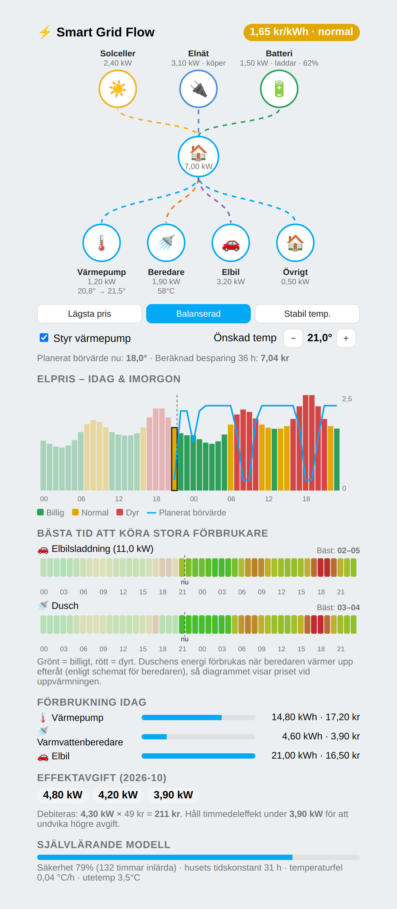

# Smart Grid Flow

Smart elstyrning för Home Assistant, på svenska. Visar värmepump, varmvattenberedare,
elpriser (nu och kommande) och förbrukning per stor förbrukare – och styr värmepumpen
så att komforten hålls till lägsta möjliga kostnad.

> **Status: 0.1.0 (första version).** Logiken (pris, modell, optimering, effekttoppar)
> är enhetstestad, men integrationen är ännu inte provkörd i en riktig Home Assistant.
> Börja gärna med styrning *avstängd* och jämför planen med verkligheten.



*Exempelbild med påhittad data, renderad av det riktiga kortet. Generera om med `python docs/demo/make_sample.py`.*

## Funktioner

- **Elpris med alla avgifter:** spotpris (elprisetjustnu.se, elområde SE1–SE4) + elhandlarpåslag
  + moms + nätens överföringsavgift + energiskatt. Standardvärden för **Göteborg Energi Elnät**
  (villa), alla justerbara i konfigurationen.
- **Effekttariff:** följer månadens tre högsta timmedeleffekter (olika dygn) via en huvudmätare
  och håller värmepumpen under tröskeln när det lönar sig.
- **Värmepumpsstyrning** med väderprognos (utetemperatur per timme), tre lägen:
  *Lägsta pris*, *Balanserad*, *Stabil temperatur*.
- **Självlärande:** efter varje timme uppdateras två modeller (rekursiv minstakvadrat):
  husets värmeförlust/uppvärmning och värmepumpens förbrukning givet börvärde och utetemperatur.
- **Varmvattenberedare:** kör de billigaste timmarna per dygn, med min/max-temperatur och legionellaskydd.
- **Bästa tid att köra:** diagram (med markering för nu) över vilka timmar som är billigast för
  elbilsladdning och dusch. Duschens energi förbrukas när beredaren värmer upp *efteråt*, så för dusch
  visas priset vid uppvärmningstimmen (enligt beredarschemat om styrning är på, annars konfigurerbar fördröjning).
- **Lovelace-kort** (registreras automatiskt): flödesbild, prisdiagram med planerat börvärde,
  förbrukning per förbrukare, effektavgift och modellstatus.
- **Animerat effektflöde:** elnät (köper/säljer), solceller, batteri (laddar/laddar ur, laddnivå),
  värmepump, beredare, elbil och övrig last. Linjerna animeras i flödesriktningen och snabbare vid högre effekt.
  Solceller/batteri/elbil visas när du anger deras effektsensorer (W/kW) i konfigurationen.
- **Utbyggbart** för solceller, batteri och elbilsladdare (se `core/devices.py`).

## Hur kopplas värmepumpen? (Mitsubishi WF-RAC)

Integrationen pratar **inte** direkt med värmepumpen – den använder entiteterna från din
befintliga [WF-RAC-integration](https://github.com/blues-sechseck/Mitsubishi-WF-RAC-Integration)
(`mitsubishi_wf_rac`; även `wf_rac` identifieras):

| Behov | WF-RAC-entitet | Används till |
|---|---|---|
| Styrning | `climate.*` | `climate.set_temperature` (endast när läget är *värme*) |
| Innetemperatur | `sensor.*` inomhus | Starttillstånd + inlärning |
| Utetemperatur | `sensor.*` utomhus | Inlärning (prognosen kommer från `weather`) |
| Energi | `sensor.*` energi (kWh) | Lär in förbrukning vid givet börvärde; kostnad per dygn |

Vid installation söker konfigurationsflödet upp dessa entiteter automatiskt. Använd helst
sensorn för **total energi** – enhetens egen räknare nollställs vid varje start, och WF-RAC
erbjuder därför en ackumulerad totalsensor. Räknare som minskar ignoreras.

Eftersom WF-RAC bara tar emot ett *börvärde* (inte effekt) modelleras värmepumpen som en
termostat: förbrukningen beror på `börvärde − innetemperatur` och `innetemp − utetemp`.
Optimeraren väljer ett börvärde per timme (dynamisk programmering över upp till 36 h).

## Installation

1. HACS → Anpassade arkiv → `https://github.com/castmo/Smart-Grid-Flow` (Integration).
2. Starta om Home Assistant.
3. Inställningar → Enheter & tjänster → Lägg till integration → **Smart Grid Flow**.
4. Lägg till kortet: `type: custom:smart-grid-flow-card` (se `dashboards/smart_grid_flow.yaml`).
5. Slå på **Styr värmepump** när planen ser rimlig ut.

## Inställningar

- **Huvudmätare** (valfri): effekt (W/kW) eller energi (kWh) för hela huset – krävs för effekttariffen.
- **Väderentitet** (valfri men rekommenderad): används för timprognos via `weather.get_forecasts`.
- **Fler förbrukare:** valfria energisensorer (t.ex. elbilsladdare) visas i kortet.

### Avgifter – verifiera!
Standardvärden (2026, inkl. moms): överföring 23 öre/kWh, energiskatt 45 öre/kWh,
effektavgift 49 kr/kW och månad, fast avgift 205 kr/mån. Hämtade från Göteborg Energis
prislista via en websökning – **kontrollera mot din faktura** och ändra under
*Konfigurera*. Elhandlarpåslaget är satt till 5 öre/kWh och beror på ditt avtal.

## Så fungerar optimeringen

```
kostnad/timme = elpris · kWh  +  komfortstraff  +  effektstraff
```
- Komfortstraffet beror på läget (Lägsta pris tillåter mer variation, Stabil temperatur straffar
  avvikelse från önskad temperatur hårt).
- Effektstraffet läggs på när timmens effekt skulle överstiga månadens 3:e högsta topp.
- Modellens säkerhet (0–100 %) växer med inlärda timmar; full efter ca 7 dygn. Innan dess
  används rimliga startvärden – kör gärna *Balanserad* de första dagarna.

## Utveckling

```bash
pip install pytest && python -m pytest -q tests
```
Kärnlogiken i `custom_components/smart_grid_flow/core/` har inga Home Assistant-beroenden.

## Licens
MIT
